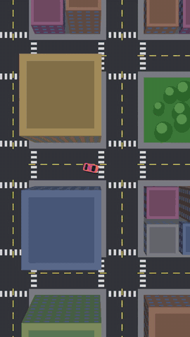
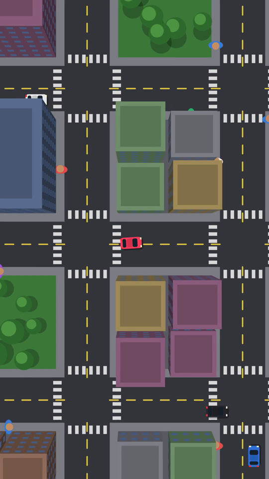
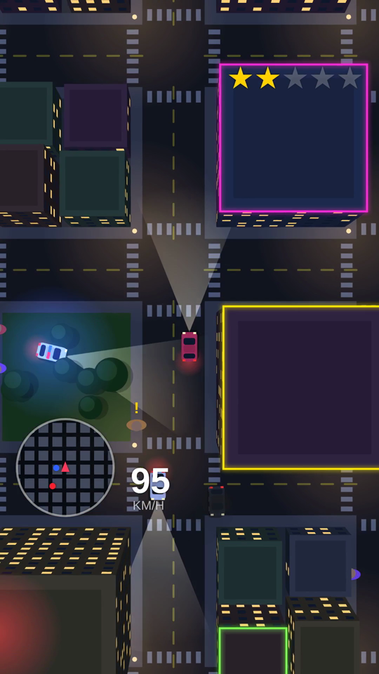

# Meu mini GTA em JavaScript

Um jogo de carro visto de cima, no estilo dos primeiros GTA, feito **só com HTML + JavaScript puro (Canvas 2D)**: sem engine, sem bibliotecas e sem nenhuma imagem. Tudo é desenhado pelo código.



**▶ Jogar online:** `https://claudineiaga.github.io/mini-gta-js/` *(veja abaixo como ativar)*

| Dia | Noite |
|---|---|
|  |  |

## Como jogar

| Computador | Celular | Ação |
|---|---|---|
| ↑ / W | ▲ | Acelerar |
| ↓ / S | ▼ | Frear / ré |
| ← → / A D | ◀ ▶ | Virar |
| Espaço | ↯ | Freio de mão (derrapar) |
| 1, 2, 3, 4 | botões 1–4 | Trocar de passo |

No computador, clique uma vez na tela antes de jogar.

## Os 4 passos

O jogo foi construído em camadas, e dá para ligar cada uma com as teclas 1 a 4:

1. **O carro.** Física com vetores: a velocidade é dividida em "pra frente" e "de lado", e o que faz o carro derrapar é o pneu não segurar a parte lateral.
2. **A cidade.** Geração procedural: ninguém desenhou o mapa. Cada quadra nasce de uma função de *hash* e é infinita. Os prédios têm perspectiva 3D de verdade.
3. **A vida.** Trânsito na mão certa (cada carro freia se tiver alguém na frente) e pedestres que fogem do carro.
4. **A noite.** Faróis, postes, janelas acesas e neon usando composição de luz (`lighter`). Bateu ou atropelou? Ganha estrela, e a polícia vem atrás com uma IA de perseguição.

## O que dá para aprender com o código

| Conceito | Onde está no `index.html` |
|---|---|
| Vetores, produto escalar, atrito | `moverVeiculo()` |
| Geração procedural com *hash* | `quadra()`, `hash()` |
| Projeção em perspectiva | `desenharPredio()` |
| Algoritmo do pintor (ordenar por distância) | `desenharPredios()` |
| Interpolação bilinear (janelas nas paredes) | `desenharPredio()` → `ponto()` |
| Colisão círculo × círculo e retângulo | `colidir()`, `solido()` |
| Agentes simples (trânsito) | `temAlguemNaFrente()`, `atualizarTransito()` |
| Perseguição com desvio de obstáculo | `atualizarPolicia()` |
| Máquina de estados (procurado → fuga → prisão) | `atualizarPolicia()` |
| Loop com passo fixo (igual em 60 Hz ou 120 Hz) | `loop()` |
| Controles de toque com vários dedos | seção `TOQUE` |

O arquivo começa com um índice das seções, e as decisões de projeto estão em [`docs/DECISOES.md`](docs/DECISOES.md).

## Rodar no seu computador

Baixe o `index.html` e abra no Chrome (ou Edge, Firefox, Safari recentes). Não precisa instalar nada.

## Publicar no GitHub Pages (link pra jogar)

1. No repositório, vá em **Settings → Pages**.
2. Em **Source**, escolha **Deploy from a branch**, branch **main** e pasta **/ (root)**, e clique em **Save**.
3. Em um ou dois minutos, o jogo fica disponível em `https://SEU-USUARIO.github.io/mini-gta-js/`.

## Estrutura

```
index.html          o jogo inteiro (um arquivo só)
docs/
  DECISOES.md       por que o código é do jeito que é
  demo.gif, *.png   imagens deste README
gravacao/           ferramentas que gravaram o vídeo do jogo (piloto automático + efeitos sonoros)
```

---

Projeto educacional, sem relação com a Rockstar Games. "GTA" e "Grand Theft Auto" são marcas da Take-Two Interactive. Nenhum conteúdo do jogo original foi usado.
